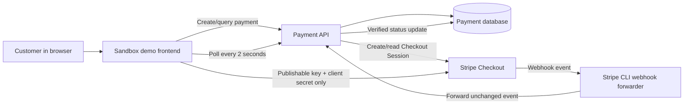
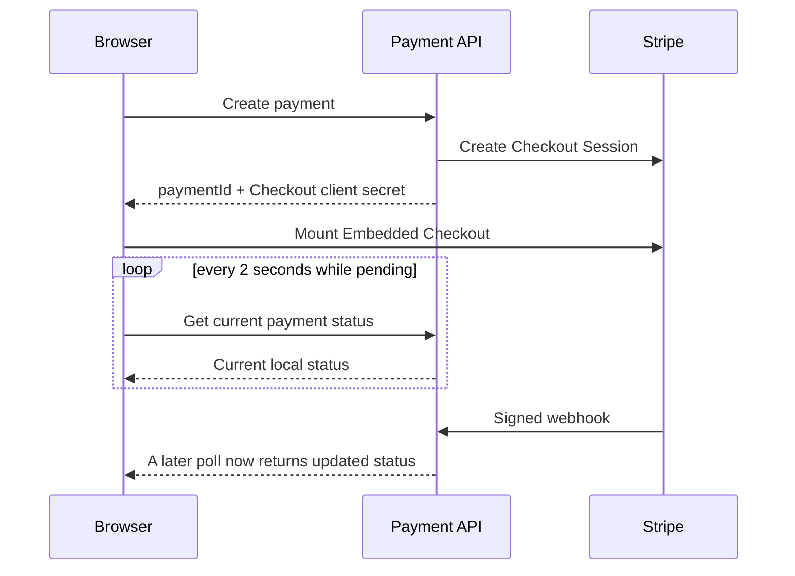

# Stripe Sandbox Demo Tutorial

This is a local teaching application, not a production storefront. It shows how a browser safely opens Stripe Embedded Checkout through the Payment API and then waits for Stripe's verified webhook result.

## What this demo does not do

- It does not collect card details itself; Stripe's embedded form does.
- It does not contain a Stripe restricted/secret API key or webhook signing secret.
- It does not call `/api/v1/webhooks/stripe`; only Stripe may do that.
- It does not decide that an order is paid from a success screen or client-side callback.

## Before you start

1. Copy the repository `.env.example` to the ignored `.env` file and add sandbox-only values.
2. Start SQL Server and the demo container: `docker compose up --build`.
3. In another terminal, start the Payment API with the documented Stripe sandbox environment variables from the repository README.
4. Forward Stripe sandbox events to the API with Stripe CLI:

   ```bash
   stripe listen --forward-thin-to http://localhost:5000/api/v1/webhooks/stripe --thin-events '*'
   ```

5. Copy the CLI-provided `whsec_...` value into the API's sandbox webhook-signing-secret configuration, then restart the API.
6. Open `https://localhost:5173` and use Stripe test payment details only.

## The people and systems involved



## Tutorial: one payment from start to finish

### 1. The page prepares itself

When the page opens, `main.js` asks `GET /api/v1/client-config/stripe` for a **publishable key**. A publishable key identifies the Stripe account to Stripe.js. It is allowed in browser code and cannot create charges by itself.

The browser never receives the Stripe restricted/secret API key (`rk_`/`sk_`) or webhook signing secret (`whsec_`). Those remain on the Payment API.

### 2. Create secure checkout

The user enters a merchant reference, amount, and currency, then clicks **Create secure checkout**. The demo sends those values and a fresh idempotency key to `POST /api/v1/payments`.

The API creates a local payment and asks Stripe to create one Embedded Checkout Session. Its response includes:

```json
{
  "paymentId": "module-guid",
  "status": "RequiresAction",
  "nextAction": {
    "type": "embedded_checkout",
    "data": { "clientSecret": "session-scoped-checkout-secret" }
  }
}
```

The **module payment ID** is the application’s own identifier. The **Checkout client secret** lets Stripe.js load only this one pre-created Checkout Session. It is not the Stripe account’s secret API key.

### 3. Stripe renders the payment form

The demo passes the publishable key and Checkout client secret to Stripe.js:

```text
Stripe(publishableKey).initEmbeddedCheckout({ clientSecret })
```

Stripe then inserts its checkout UI into the empty `#checkout` area. The customer enters payment information into Stripe-controlled UI; the demo JavaScript and Payment API do not receive raw card details.

### 4. The demo polls while Stripe processes payment

Immediately after mounting checkout, the demo calls `GET /api/v1/payments/{paymentId}` and repeats that request every two seconds. This is not a call to Stripe and not a call to the webhook endpoint. It simply asks the Payment API, “what is the latest trusted local status?”



### 5. Stripe, not the browser, calls the webhook

After payment activity, Stripe sends an event such as `checkout.session.completed` to the Payment API. Stripe CLI forwards that sandbox event to the local API during this tutorial.

The API verifies the Stripe signature using its server-only webhook signing secret, ignores duplicate event IDs, reads the authoritative Stripe Session/PaymentIntent where required, and updates the local payment status.

Only after this verified update does a later poll show **Succeeded**, reveal the refund panel, and stop polling.

## Reading the page

| Page item | Meaning |
| --- | --- |
| Payment ID | The Payment API’s provider-neutral GUID. Use it to query the module. |
| Provider reference | The Stripe Checkout Session ID (`cs_...`) for sandbox troubleshooting. |
| Status | The local, webhook-updated payment lifecycle state. |
| Webhook confirmation | Explains whether the UI is still waiting or has observed a verified Stripe event. |
| Last payment update | When the Payment API last updated the local payment record. |

## Refund tutorial

The refund panel appears only after a payment is marked `Succeeded`. It sends `POST /api/v1/payments/{paymentId}/refunds` with an idempotency key and amount. The Payment API calls Stripe using its server-side credential; the browser does not call Stripe’s refund API.

Stripe refund events also reach the verified webhook handler. A production application would normally display refund status from the API's refund query response rather than assuming the browser request alone completed the money movement.

## Source guide

| File | Read it for |
| --- | --- |
| `index.html` | The visible parts of the tutorial page and where Stripe mounts its UI. |
| `src/main.js` | Numbered browser interaction steps, API calls, polling, and refund request. |
| `src/styles.css` | The page's visual layout, with plain-language section comments. |
| `vite.config.js` | Why the local demo uses HTTPS and requires a development certificate. |
| `Dockerfile` | How the demo’s local Vite server is packaged. |

For the server-side counterpart, read [`../../src/Payment.Infrastructure/Providers/Stripe/README.md`](../../src/Payment.Infrastructure/Providers/Stripe/README.md).
