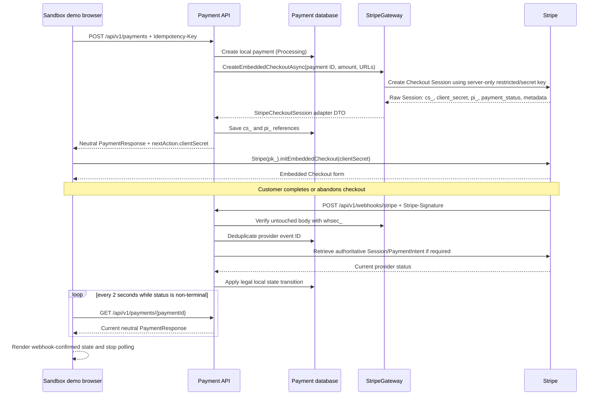

# Stripe embedded Checkout: keys, objects, and webhook flow

This folder adapts Stripe Checkout to the payment module. It creates an embedded Checkout Session, then converts verified Stripe webhook events into provider-neutral payment statuses. The browser never decides that money was received; a verified Stripe webhook does.

## Keys, secrets, and identifiers

| Value | Prefix | Where it is allowed | Purpose | Secret? |
| --- | --- | --- | --- | --- |
| Stripe restricted/secret API key | `rk_` or `sk_` | Payment API only | Lets `StripeGateway` create/read Checkout Sessions, PaymentIntents, and refunds. Prefer a restricted key with only needed permissions. | Yes |
| Publishable key | `pk_` | Browser demo | Initializes Stripe.js for the Stripe account. It cannot create charges itself. | No |
| Webhook signing secret | `whsec_` | Payment API only | Verifies that a webhook came from Stripe and was not changed. | Yes |
| Checkout Session ID | `cs_` | Payment API/database/Stripe Dashboard | Identifies one Checkout Session; stored as the module provider reference. | No authorization credential |
| Checkout client secret | Session-scoped Stripe value | Browser for this one Checkout Session | Lets Stripe.js load and render the already-created Embedded Checkout Session. | Do not log or persist in browser storage |
| PaymentIntent ID | `pi_` | Payment API/database/Stripe Dashboard | Identifies Stripe's underlying payment attempt; needed to create refunds. | No authorization credential |
| Module payment ID | GUID | Payment API/database/demo | Provider-neutral ID created by this application to link local and Stripe records. | No |

The publishable key and Checkout client secret have different jobs: the publishable key initializes Stripe.js for an account; the client secret gives Stripe.js access to one specific Checkout Session. Secret/restricted keys and webhook signing secrets must never appear in the browser, source code, logs, metrics, or API responses.

## Interaction diagram



## From create Checkout Session to the API response

1. The demo sends a provider-neutral command to `POST /api/v1/payments`: merchant reference, amount, currency, payment method, return/cancel URLs, and idempotency key.
2. `PaymentService.CreateAsync` validates it and persists a local `Processing` payment with its own GUID.
3. The Card provider resolves to `StripeProvider`, which calls `StripeGateway.CreateEmbeddedCheckoutAsync`.
4. The gateway creates an embedded Checkout Session. It writes the module payment GUID to `client_reference_id` and to Session/PaymentIntent `payment_id` metadata. It also uses that GUID as Stripe's create idempotency key.
5. Stripe returns a raw `Session` SDK object. The gateway maps only the needed fields into `StripeCheckoutSession`.
6. `StripeProvider` changes the local outcome to `RequiresAction` and returns a provider-neutral `ProviderNextAction` to the module.
7. `PaymentsController` serializes the neutral `PaymentResponse`; it never returns Stripe's raw SDK Session object.

## Raw Stripe Checkout Session object

Stripe returns a large object. The following is the relevant illustrative subset, shown here for learning/debugging only. It is not the public Payment API response:

```json
{
  "id": "cs_test_...",
  "object": "checkout.session",
  "ui_mode": "embedded",
  "mode": "payment",
  "client_secret": "cs_test_..._secret_...",
  "payment_intent": "pi_...",
  "payment_status": "unpaid",
  "client_reference_id": "8d71e7ce-...",
  "metadata": { "payment_id": "8d71e7ce-..." },
  "status": "open"
}
```

The adapter maps the actual Stripe SDK `Session` to an internal DTO:

```csharp
new StripeCheckoutSession(
    session.Id,
    session.ClientSecret,
    session.PaymentIntentId,
    session.PaymentStatus,
    session.Metadata,
    session.ClientReferenceId);
```

The raw SDK object stays inside `Payment.Infrastructure` so application/business code does not need Stripe SDK types.

## Provider-neutral next action

The module cannot return raw Stripe `Session` objects as its API contract because another provider has different object types. It returns its own stable response instead:

```json
{
  "paymentId": "8d71e7ce-...",
  "merchantReference": "reservation-demo-001",
  "amount": 500.00,
  "currency": "EGP",
  "method": "Card",
  "provider": "Stripe",
  "providerReference": "cs_test_...",
  "status": "RequiresAction",
  "nextAction": {
    "type": "embedded_checkout",
    "data": { "clientSecret": "cs_test_..._secret_..." }
  }
}
```

| Neutral field | Meaning |
| --- | --- |
| `status: RequiresAction` | Customer must complete a provider UI. It does not mean payment success. |
| `nextAction.type` | Browser action owned by the module contract. Here it means mount embedded Checkout; another provider could use a neutral `redirect` action. |
| `nextAction.data.clientSecret` | The minimum session-scoped value Stripe.js needs to mount this Checkout Session. It is not the Stripe account secret key. |
| `providerReference` | Stored Checkout Session ID. The demo displays it only to aid sandbox debugging. |

The client secret is intentionally delivered to the browser because Stripe requires it for Embedded Checkout. The API still never returns a raw Stripe Session, Stripe secret/restricted key, webhook signing secret, raw webhook event, or full PaymentIntent object.

## After the demo receives payment ID and client secret

1. The demo saves only the module `paymentId` in `sessionStorage` so a refresh can resume status polling.
2. It calls `Stripe(publishableKey).initEmbeddedCheckout({ clientSecret })` and mounts the Stripe-controlled checkout form.
3. It starts `GET /api/v1/payments/{paymentId}` polling immediately and every two seconds while the local status is non-terminal.
4. The customer enters card/payment data directly into Stripe's iframe/UI. Card data never passes through the demo JavaScript or Payment API.
5. Stripe sends events to `/api/v1/webhooks/stripe`; the browser must never call this endpoint.
6. `StripeWebhooksController` passes the untouched request body and `Stripe-Signature` to `StripeWebhookHandler`. The handler verifies the signature with `whsec_`, deduplicates the event ID, retrieves the current authoritative Session/PaymentIntent when needed, and applies only legal local transitions.
7. The next frontend poll sees the changed local record. The demo marks the state as webhook-confirmed, shows `updatedAt`, and stops polling for `Succeeded`, `Failed`, `Cancelled`, or `RequiresReconciliation`.

Return/completion UI is only a user-experience signal. It must not fulfill an order or confirm a reservation; those effects follow the verified webhook-updated state.

## Webhook mapping

| Stripe event | Additional check | Module status |
| --- | --- | --- |
| `checkout.session.completed` | Session `payment_status` is `paid` | `Succeeded` |
| `checkout.session.async_payment_succeeded` | — | `Succeeded` |
| `checkout.session.async_payment_failed` | — | `Failed` |
| `checkout.session.expired` | — | `Cancelled` |
| `payment_intent.succeeded` | — | `Succeeded` |
| `payment_intent.payment_failed` | — | `Failed` |
| `payment_intent.requires_action` | — | `RequiresAction` |
| `refund.created` / `refund.updated` | Refund metadata includes module refund ID | Update local refund |

Duplicate events are safe: `ProviderWebhookEvents` stores one record per provider/event ID, so a duplicate exits without applying the business effect twice.
